  

  

  
  

---

## 👨‍💻 About me

I build and operate **production web platforms end-to-end** — from the database schema and API, through the UI, to the servers, pipelines and dashboards they run on.

- ⚙️ Backend in **Python** & **Go**: Django, DRF, FastAPI, Celery, Channels
- 🎨 Frontend in **TypeScript**: Next.js, React, RTK Query, Mantine
- 🚀 Infra: Docker, Nginx, Cloudflare, CI/CD and self-built release tooling
- 🔭 Observability first: OpenTelemetry, Jaeger, Grafana, Prometheus

  

## 🛠 Tech stack

  
   
  

  
  
  
  
  
  
  
  

## 🔧 Tools I've built

<table>
  <tr>
    <td width="50%" valign="top">
      <h3>🚢 luxen</h3>
      
      
Config-driven <b>release &amp; deploy CLI</b>: CI gates, semver releases, GHCR images, health-checked deploys and one-command rollback.

    </td>
    <td width="50%" valign="top">
      <h3>🌐 <a href="https://github.com/thelol3882/lexen">lexen</a></h3>
      
      
      
Config-driven <b>translation extraction, validation &amp; sorting</b> for next-intl, react-i18next and friends — built on the TypeScript compiler API.

    </td>
  </tr>
</table>

## 🔭 Featured work

<table>
  <tr>
    <td valign="top">
      <h3>🚆 <a href="https://github.com/thelol3882/hackathon_nu26">Locomotive Digital Twin</a></h3>
      NU Hackathon 2026
      
FastAPI microservices, Redis Streams, TimescaleDB and gRPC, with full Grafana / Prometheus / Jaeger observability.

      
      
      
      
    </td>
  </tr>
</table>

## 🐍 Contribution activity

  <picture>
    <source media="(prefers-color-scheme: dark)" srcset="https://raw.githubusercontent.com/thelol3882/thelol3882/output/snake-dark.svg"/>
    <source media="(prefers-color-scheme: light)" srcset="https://raw.githubusercontent.com/thelol3882/thelol3882/output/snake.svg"/>
    
  </picture>

