

  

  

  
  

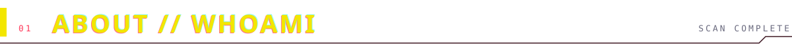

I build **backend systems and the platforms around them** — schema, APIs, infra and observability, plus enough UI to ship end-to-end.

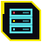&nbsp; <b>BACKEND</b> — Go &amp; Python: services &amp; CLIs in Go, gRPC; Django, DRF, FastAPI, Celery, Channels

&nbsp; <b>FRONTEND</b> — TypeScript: Next.js, React, RTK Query, Mantine

&nbsp; <b>INFRA</b> — Docker, Nginx, Cloudflare, CI/CD and self-built release tooling

&nbsp; <b>OBSERVABILITY</b> — OpenTelemetry, Jaeger, Grafana, Prometheus

  

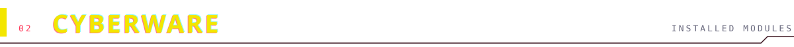

  
   
  

  
  
  
  
  
  
  
  
  
  

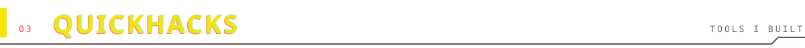

  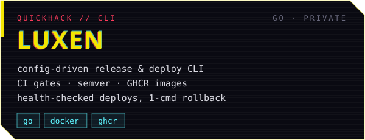
  <a href="https://github.com/thelol3882/lexen">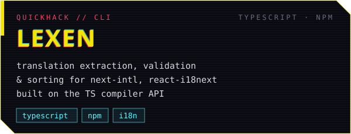</a>

  

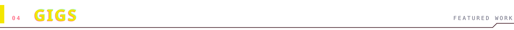

  <a href="https://github.com/thelol3882/hackathon_nu26">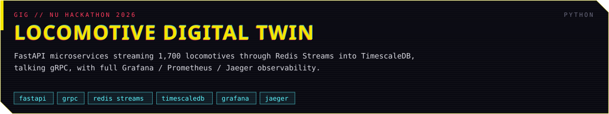</a>

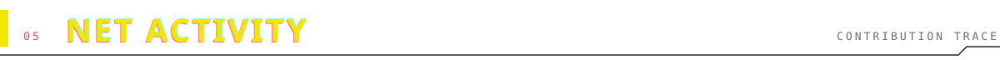

  

